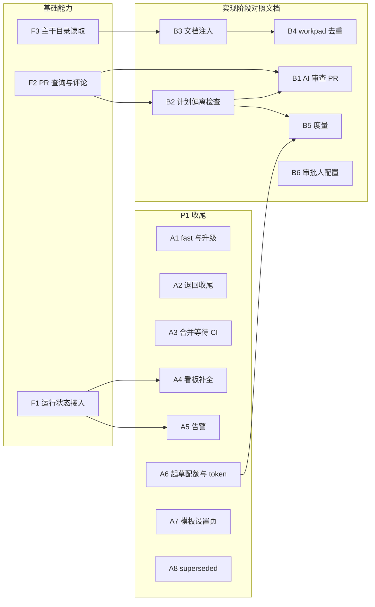
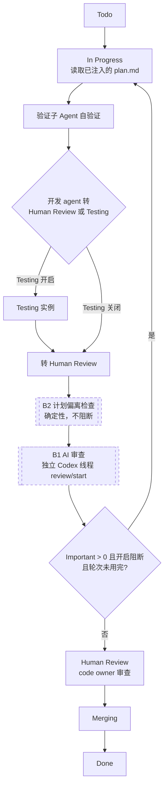

# AI 原生 SDLC 第二期方案（实现阶段对照文档 + 第一期收尾）

> **范围**：承接 [ai-native-sdlc-flow-design.md](./ai-native-sdlc-flow-design.md)（下称“P1 方案”）。本文覆盖 P1 方案第 12 节的 P2 内容，以及 P1 落地后核对出的缺口。P3（外部信号 → intent、组织规则仓库、组织配置 eval）和 teamwork 运行时不在本文范围。
>
> **状态**：已定稿（2026-11-13）。第 12 节的决策全部按推荐项确定。
>
> **任务管理**：GitHub 里程碑 “AI 原生 SDLC P2”，每个父 issue 对应本文一节，子 issue 对应一个可独立合并的 PR（第 11 节）。
>
> **依据**：
> - P1 方案第 1、7、8、12 节。
> - Playbook Stage 5 “AI in the PR review loop”，总结文档 `bilibili-docs/BV1tJem6eEg6/ai-native-sdlc-animation.html`。
> - 2026-11-13 对当前代码的核对结果（第 1 节）。
> - Codex CLI 0.158.0 的 app-server 协议（`codex app-server generate-json-schema`）：`review/start`、`exitedReviewMode`、`thread/tokenUsage/updated`。

## 1. 现状核对

P1 的主体已经实现：三道文档闸门、文档状态机与级联、正文哈希、三类模板与校验、6 个 `doc:*` label、文档 MR 合并、退回文档阶段（r2）、看板五列。代码在 `web-platform/src/sdlc/`、`handlers/change_docs.rs`、`handlers/kanban.rs` 和前端 `components/workbench/`、`components/kanban/StageBoard.tsx`。

下表是还没有实现的部分。编号在后文沿用。

| 编号 | 内容 | 来源 | 现状 |
|---|---|---|---|
| B1 | AI 审查 PR：对照 spec / plan，读取 `REVIEW.md` | P1 方案 7-4、10.2-15 | 没有独立审查者；只有开发 agent 处理 PR 上已有的评论 |
| B2 | 计划偏离检查：diff 文件对比 `plan.md` 的 `## Files` | P1 方案 7-3 | 没有，`rust-platform/src/agent/post_run.rs` 没有这项检查 |
| B3 | 提示词注入已批准文档的路径和 SHA，只在有文档时注入 | P1 方案 7-1 | 模板里是固定文字，没有 SHA，所有 issue 都会渲染这一段 |
| B4 | workpad 去重：有 `plan.md` 时 workpad 不再自己写计划 | P1 方案 7-2 | 没有 |
| B5 | 度量：intent 存活率、设计阶段周期、需求返工、首轮合并率、计划一致性 | P1 方案第 8 节 | 没有 |
| B6 | 闸门审批人配置 | P1 方案第 6 节、第 12 节 | 没有，任何项目成员都能批准 |
| A1 | `track:fast` 与白名单；路径只能升级 | P1 方案决策 3 | `Track` 只有 `full`、`plan`；没有升级接口 |
| A2 | 退回文档阶段的收尾 | P1 方案 10.2-17 | 前端不传 `codeMrIid`，代码 MR 不会转 Draft；实现分支名要手填；r2 合入后实现分支不会合入新主干 |
| A3 | 文档 MR 合并：等待 CI、细分失败原因、项目 Token 不可用提示 | P1 方案 10.1、10.2 第 5 步 | 不等 CI 直接合并；失败原因统一成一句；Token 失效只在接口报错时出现 |
| A4 | 看板补全 | P1 方案 9.3、9.4 | 卡片不提示 label 与文档状态不一致；实现阶段没有“AI 运行中”；Human Review 没有等待时长；没有“已批准待合并”子状态；全局看板没用阶段分列 |
| A5 | 告警区分等人审批和 agent 运行 | P1 方案决策 4 | `alert/metrics.rs` 的 `running_tasks` 一直是空表，超时规则实际不会触发 |
| A6 | 起草会话配额、排队和 token 统计 | P1 方案 4.7 | 会话满了直接报错；web-platform 和 rust-platform 都没处理 `thread/tokenUsage/updated` |
| A7 | 项目设置 → 文档模板页面 | P1 方案 5.4 | 没有页面；项目级模板只能覆盖骨架 |
| A8 | 文档状态 `superseded` | P1 方案 4.2 | 没有 |

核对中还发现三处基础能力缺失，多个条目都依赖它们，单独列为 F 类：

| 编号 | 缺什么 | 谁依赖 |
|---|---|---|
| F1 | web-platform 拿不到 rust-platform 的运行状态。rust-platform 有 `GET /api/v1/state`（`server/api.rs`），但只在配置了端口时才启动，而 `process_manager/spawn.rs` 启动服务时不传端口 | A4、A5 |
| F2 | rust-platform 不能按分支查 PR/MR，也不能在 PR/MR 上发评论。PR 由 agent 用 `gh` / `glab` 创建，rust 侧不知道 PR 编号 | B1、B2 |
| F3 | rust-platform 不能读取主干上的目录清单，GitHub 单仓库是 legacy 布局（agent 自己 clone），渲染第一轮提示词时本地还没有代码 | B3、B4 |

## 2. 总体结构



实现后的实现阶段流程如下。虚线框是本期新增的步骤。



## 3. 基础能力

### F1 实现阶段运行状态接入

**做法**：

1. `process_manager/spawn.rs` 启动开发实例和测试实例时，从本地空闲端口中分配一个，用 `--port` 传给 rust-platform，记录在 `ProcessState.api_port`。rust-platform 的 HTTP 服务只监听 `127.0.0.1`（`server/mod.rs`），不对外暴露。
2. web-platform 新增 `services/runtime_state.rs`：每 10 秒轮询所有运行中项目的 `GET /api/v1/state`，缓存最近一次结果。单个项目请求超时 2 秒，失败时保留上次结果并标记 `stale`。
3. 缓存的用途：
   - 看板卡片的“AI 运行中”（A4）；
   - 告警的 `running_tasks`（A5）；
   - 调用 `ConcurrencyManager::report_project_agents`，这个方法目前没有调用方。

**不做**：不改 rust-platform 状态接口的响应结构，只消费现有的 `running[]`（`issue_identifier`、`state`、`started_at`、`last_event_at`、`tokens`）和 `retrying[]`。

### F2 PR 查询与评论

在 rust-platform 的 `Platform` trait（`platform/mod.rs`）新增两个方法，实现 GitHub、GitLab、Gitea 三个平台；`memory.rs` 提供测试实现。

```rust
async fn find_open_pull_request(&self, repo_slug: &str, branch: &str)
    -> Result<Option<PullRequestRef>, PlatformError>;
async fn upsert_pull_request_comment(&self, repo_slug: &str, pr: &PullRequestRef,
    marker: &str, body: &str, mode: CommentMode) -> Result<(), PlatformError>;
```

- `repo_slug` 显式传入，多仓库项目可以对每个仓库的 MR 操作。单仓库项目传项目 slug。
- `CommentMode::Upsert`：找到正文包含 `marker` 的评论就更新，否则新建，用于偏离检查。`CommentMode::Append`：每次新建，用于 AI 审查，保留每轮记录。
- GitHub / Gitea 的 PR 评论走 issue comments 接口；GitLab 走 MR notes 接口。
- 分支名来源：多仓库用 `RepoState.branch`；single_root / legacy 用 `git symbolic-ref --short -q HEAD`，与 `gate_check` 的取法一致。
- Linear tracker 不支持，调用方跳过。

### F3 主干目录读取

`Platform` 新增 `list_directory(repo_slug, path, git_ref) -> Option<Vec<RepoFile{name, path, blob_sha}>>`。目录不存在时返回 `None`。GitHub 用 contents API，GitLab 用 repository tree API，Gitea 用 contents API。

## 4. 实现阶段对照文档

### B3 已批准文档注入

**数据来源**：文档 MR 合并后，三份文档在主干的 `docs/changes/<iid>/`。runner 在第 1 轮渲染前调用一次 F3，读取主仓库默认分支上的这个目录，结果在本次 run 内缓存。这样不依赖工作区布局，GitHub 的 legacy 布局也能用。

**新增 liquid 变量** `change_docs`（`rust-platform/src/prompt/mod.rs` 的 `RunGlobals`）：

```yaml
change_docs:            # 目录不存在或 tracker 不支持时为 nil
  dir: docs/changes/123 # 多仓库时前面加上主仓库的 path，例如 backend/docs/changes/123
  ref: main
  files:
    - { name: plan.md,  blob_sha: 1a2b3c4d5e6f }
    - { name: spec.md,  blob_sha: ... }
    - { name: intent.md, blob_sha: ... }
```

`blob_sha` 是 git 的 blob SHA，取前 12 位，用来表明 agent 读的是哪个版本。批准绑定仍然用 web-platform 数据库里的正文哈希（P1 方案 4.4），两者不需要一致。

**模板改动**（`web-platform/src/templates/workflow_{github,gitlab,gitea}.md`）：把现在固定的 “Approved change documents” 一段改成 ` … `，列出文件和 SHA；原有规则（先读 plan.md、偏离时在同一个 commit 更新 plan.md、plan.md 不能覆盖安全规则、不得改回 `doc:*`）保留。

### B4 workpad 去重

在 B3 的条件块里加入规则：有 `plan.md` 时，workpad 的 `Plan` 一节只写 “见 `<dir>/plan.md`” 和按 plan 步骤列的进度勾选项，不再自己展开计划；Step 1 “Expand/fix the plan” 和 “principal-style self-review of the plan” 改为“核对 plan.md 是否能执行，发现问题写进 Notes”。没有 `plan.md`（`track:fast`）时保持现状。

### B2 计划偏离检查

**时机**：`runner.rs` 的 `post_run_checks` 中，本次 run 结束状态为 `Human Review` 或 `Testing` 时执行，排在 `gate_check` 之后。不阻断，任何失败只记日志。

**输入**：
- 改动文件集合 D：对每个可写仓库执行 `git diff --name-only origin/<default>...HEAD`（与 `gate_check` 相同），多仓库加 `<alias>/` 前缀，单仓库不加；排除 `docs/changes/<iid>/` 下的文件。
- 计划文件集合 P：读取当前分支工作区里的 `docs/changes/<iid>/plan.md`（实现期修订过的版本优先），解析 `## Files` 小节。

**`## Files` 语法**（同步写进 plan 模板的写作指引）：

```markdown
## Files
- backend/src/claims/progress.rs
- frontend/src/pages/claims/      # 以 / 结尾表示整个目录
- `backend/tests/claims_progress.rs`  # 允许反引号；# 之后是注释
```

**结果**：
- `unplanned` = D 中没有被 P 覆盖的文件；`untouched` = P 中没有被任何改动覆盖的条目。
- 两者都为空时结果为“一致”，否则为“偏离”。
- 没有 `plan.md` 时不检查。

**写回**：
1. PR 评论，`CommentMode::Upsert`，marker 为 `<!-- symphony:plan-check -->`。多仓库发在主仓库的 MR 上，按仓库分组列出。
2. workpad 新增 `### Symphony plan check` 一节，复用 `post_run::with_section`。
3. 偏离时加 label `plan-deviation`，一致时移除。B5 的“计划一致性”读这个 label。

代码放在 `post_run.rs`：解析和比对是纯函数，单元测试覆盖；写回在 runner 中。

### B1 AI 审查 PR

**目标**：每个进入 Human Review 的 PR 都经过同一套审查规则，结论按严重度列出，供 code owner 判断意图和风险。写代码的 agent 不能审查自己，也不能批准 PR。

**执行者**：rust-platform 在 `post_run_checks` 里另起一个 Codex app-server 进程，开新线程，对每个可写仓库调用 `review/start`：

```json
{"method":"review/start","params":{"threadId":"<新线程>","target":{"type":"baseBranch","branch":"<default_branch>"}}}
```

- 新线程在该仓库目录下启动，与开发会话没有共享上下文。
- `developer_instructions` 依次放入：`post_run::SAFETY_RULES`；审查政策（目标仓库根目录的 `REVIEW.md`，没有时用内置默认，取自 Playbook 原文模板）；已批准文档的路径（`change_docs`），要求对照 `spec.md` 的需求和 `plan.md` 的步骤与 `## Files` 检查；B2 的偏离结果。
- 审查线程只读：命令审批一律拒绝写操作，处理方式与 `web-platform/src/sdlc/agent.rs` 的非交互策略相同。
- 审查结果取 `exitedReviewMode` 条目的 `review` 文本。

**触发条件**（全部满足）：
1. 项目开启了 AI 审查（WORKFLOW front matter `review.enabled: true`，由项目设置渲染）；
2. 本次 run 结束状态为 `Human Review`；
3. 能用 F2 找到该分支的打开中的 PR；
4. 各仓库 HEAD 与上一轮审查记录的 HEAD 不同。上一轮记录从 PR 评论的 marker 中读取。

开启 Testing 时，开发实例结束在 `Testing`，不触发；测试实例转到 `Human Review` 时触发。因此测试模板 `workflow_test_*.md` 也要渲染 `review` 配置。

**严重度**：Codex 审查输出的条目带 `[P0]`–`[P3]` 标记。P0、P1 计为 Important，P2、P3 计为 Nit。`REVIEW.md` 可以重新定义两者的含义，但输出标记不变。解析不出标记时计数记为“未知”，按不阻断处理，并在评论里说明。实现的第一个子 issue 先用 Codex 0.158 实际跑一次，确认输出格式（第 10 节风险 R1）。

**写回**：
- PR 评论，`CommentMode::Append`，每轮一条：

  ```markdown
  ## Symphony AI 审查（第 2 轮）
  Important 1 · Nit 3 · 对照：plan.md@1a2b3c4d5e6f、spec.md@… · 审查政策：REVIEW.md（仓库）
  ### Important
  - [P1] …
  ### Nit（最多 5 条，其余计数）
  - [P3] …
  <!-- symphony:ai-review round=2 heads=primary:abc123def456 important=1 nit=3 -->
  ```
- 审查期间加 label `ai-review-running`，结束后移除；Important > 0 时加 `ai-review-important`，否则移除。
- workpad 新增 `### Symphony AI review` 一节，只放计数和评论链接。

**阻断**（决策 D2）：项目设置 `review.block_on: important` 时，Important > 0 且轮次小于 `review.max_rounds`（默认 2），Symphony 把 issue 改回 `In Progress`。开发 agent 下一次 run 时，现有的 PR 反馈处理流程（模板 “MR feedback sweep”）会把 AI 审查评论当作待处理的审查意见，修复或回复后重新转到 Human Review，再触发下一轮审查。轮次用完后停在 Human Review，加 label `ai-review-unresolved`。以下情况不阻断：交接时带有 `symphony:blocked` 标记（验证失败或权限受阻），或计数“未知”。

**模板改动**：开发模板的 PR 反馈处理一节写明，带 `symphony:ai-review` 标记的评论来自 Symphony 审查者：Important 必须修复或给出理由回复，Nit 可选择性处理；不得删除或修改这些评论。

**配置**（WORKFLOW front matter，由 web-platform 按项目设置渲染，方式同 `validation.gate`）：

```yaml
review:
  enabled: true
  block_on: none        # none | important
  max_rounds: 2
  timeout_ms: 900000    # 单个仓库的审查超时
```

项目设置新增“AI 审查”开关和“Important 自动打回”开关，存在 `projects` 表（V021）。

**生命周期**：审查在 worker 的收尾阶段运行，占用该 worker 的并发名额。审查使用独立的取消令牌，只在服务停止或超时时取消，不随 issue 状态变化取消，因为 issue 此时已经不在活跃状态（风险 R2）。

### B5 度量

接口 `GET /api/projects/{id}/sdlc/metrics?days=30`，在项目看板页顶部用一个可折叠的度量条展示。

| 指标 | 计算方式 | 数据来源 |
|---|---|---|
| intent 存活率 | 窗口内 G1 的接受数 ÷（接受数 + 拒绝数） | `document_approvals` |
| 设计阶段周期 | G1 批准到 G2 批准的中位数和 P90 | `document_approvals` |
| 需求返工 | plan 首次提交审阅后，spec 又被修改或被级联置为 stale 的次数 | 新表 `flow_events`（V022） |
| 首轮合并率 | 已关闭且未被拒绝的 issue 中，从未带过 `Rework` label 的比例 | 平台 label 事件（GitLab `resource_label_events`、GitHub issue events），结果按 issue 缓存 |
| 计划一致性 | 已关闭的有 plan 的 issue 中，关闭时不带 `plan-deviation` 的比例 | 已关闭 issue 的 label |
| 起草 token | 窗口内文档起草会话的 token 总量 | A6 的 `agent_token_usage` |

`flow_events` 记录 `flow_id, kind（cascade_stale / revision_started / docs_merged / revert）, doc_type, actor, created_at`，在 `service.rs` 的对应位置写入。

### B6 闸门审批人配置

- 新表 `gate_approvers(project_id, gate, user_id)`（V023）。某道闸门没有配置人时，保持现状：任何项目成员都能批准。
- `service::decide` 在批准、要求修改、拒绝前检查调用者是否在该闸门名单里（系统管理员不受限）。
- 接口 `GET/PUT /api/projects/{id}/gate-approvers`，只有项目 owner 能修改。
- 项目设置新增“闸门审批人”一节；工作台的流程插槽在不能批准时禁用按钮，并显示“仅 X、Y 可批准”。
- “发起人不能批准自己的文档”仍不启用（P1 方案 M1）。

## 5. 第一期收尾

### A1 `track:fast` 与路径升级

- **fast**：看板卡片“开始文档流程”增加 `fast` 选项，只有 issue 带有白名单 label 时可选。白名单是项目设置 `fast_track_labels`，默认 `hotfix`、`docs-only`（V021）。选择后加 `track:fast` 和 Todo label，不创建 flow 记录，不开文档 MR。
- **升级**：新增 `POST /api/projects/{id}/changes/{iid}/upgrade`。
  - `fast → plan / full`：只在 issue 还停在 Todo、没被编排器领取时允许；移除 Todo label 后按 `start_flow` 建立文档流程。
  - `plan → full`：只在文档 MR 合并前允许；在同一个文档分支上创建 intent 草稿，track 改为 full。已有的 plan 如果是已批准或待审，置为 stale，G2 通过后重新审阅。
  - 不允许降级。
- **手动改为 Todo**（P1 方案 4.1）：卡片显示“label 与文档状态不一致，按 fast 处理”，flow 记录不变。

### A2 退回文档阶段收尾

1. 后端在请求没带参数时自己查找：用 `get_issue_merge_requests` 取该 issue 打开中的 MR，排除 `symphony/docs-` 分支；多仓库项目经 `multi_repo_mrs::filter_related` 过滤。所有找到的代码 MR 都转为 Draft；实现分支取主仓库那个 MR 的 `source_branch`。需要先让 `MergeRequestSummary` 带上 `source_branch`。
2. 新增 `GET .../changes/{iid}/revert-preview`，退回对话框只读显示将被转为 Draft 的 MR 和实现分支，去掉手填输入框。
3. r2 合入主干后，web-platform 在 issue 上发评论，附 marker `<!-- symphony:docs-revision r2 sha=<merge commit> -->`。开发模板新增规则：issue 上有比本分支最近一次合入主干更新的 `docs-revision` 标记时，先 merge `origin/<default>`，`docs/changes/<iid>/` 下的冲突一律取主干版本。
4. 停止实现 agent 仍靠移除实现阶段 label。补一个集成测试，确认编排器对账时会取消该 issue 的 worker。

### A3 文档 MR 合并：等待 CI 与失败原因

- **等待 CI**：`merge_docs` 把 MR 转为 Ready 后，在后台任务中每 15 秒查询一次 CI 状态，最多等 `SYMPHONY_DOCS_MERGE_CI_TIMEOUT_SECS`（默认 600 秒）。期间卡片显示“等待 CI”。没有流水线时直接合并；CI 失败或超时写入 `merge_error`，可以重试。
  - GitLab：MR 的 `head_pipeline.status`。
  - GitHub：head commit 的 combined status 和 check runs，需要在 `github_client.rs` 新增方法（目前 GitHub 的 `ci_status` 恒为空）。
- **失败原因细分**：合并被拒后再查一次 MR。GitLab 读 `detailed_merge_status`（`ci_must_pass`、`not_approved`、`conflict`、`discussions_not_resolved` 等），GitHub 读 `mergeable_state`（`blocked`、`behind`、`dirty`、`unstable`）。分别给出提示，其中包括“平台要求另一位成员审批”。
- **项目 Token 状态**：新增 `GET /api/projects/{id}/token-status`，校验项目创建者的 Token，结果缓存 10 分钟。项目设置页和看板顶部在 Token 不可用时显示提示。

### A4 看板补全

| 项 | 做法 |
|---|---|
| label 与文档状态不一致 | `build_stage_columns` 根据 flow 状态算出期望的 `doc:*` label，与 issue 实际 label 比较，不一致时设 `placement.anomaly` 和提示文案 |
| 实现阶段“AI 运行中” | 用 F1 的缓存，issue 在 `running[]` 里时卡片显示“AI 运行中”和本次运行时长 |
| Human Review 等待时长 | 只对处于 Human Review 的卡片查询平台 label 事件，取最近一次加上该 label 的时间，缓存 60 秒 |
| “已批准待合并” | flow 状态为 `PlanApprovedPendingMerge` 时子状态显示“已批准待合并”，合并失败时显示失败原因 |
| 全局看板 | 新增 `GET /api/overview/kanban/stages`，按项目调用 `build_stage_columns` 后合并。全局看板页默认显示阶段视图，保留切换到旧视图的开关（决策 D6） |

### A5 告警

`DefaultMetricCollector::collect` 用 F1 的缓存填充 `running_tasks`。rust-platform 只在活跃状态下运行 agent，`Human Review` 和 `doc:*-review` 不会出现在 `running[]` 里，所以等人审批不会触发超时告警。规则里再加一层过滤：状态属于等人审批类的条目跳过，防止配置把这些状态误设为活跃状态。

### A6 起草会话配额、排队与 token

- **排队**：非交互起草（`spawn_draft`）改为等待名额，最多等 10 分钟，期间卡片显示“排队中”；交互会话仍然立即返回“AI 会话已达上限”。
- **配额**：继续使用 `SYMPHONY_DOC_AGENT_MAX_SESSIONS`，不计入 `MAX_CONCURRENT_CODEX`（决策 D9）。`ConcurrencyManager::get_status` 增加 `doc_sessions {active, max, queued}` 字段供展示。
- **token**：`sdlc/agent.rs` 处理 `thread/tokenUsage/updated`，取 `tokenUsage.last` 写入新表 `agent_token_usage(flow_id, doc_type, thread_id, turn_id, input, cached_input, output, reasoning, total, created_at)`（V022）。工作台显示当前文档累计用量。
- **rust-platform**：`codex_client.rs` 的 `extract_usage_from_message` 目前只读 `usage` 和 `/params/turn/usage`，不认识 `thread/tokenUsage/updated`。增加这个通知的解析，用 `tokenUsage.total` 计算增量，修正编排器的 token 统计。先用真实事件确认目前是否确实漏计。

### A7 文档模板设置页

- **生效模板**：`GET /api/projects/{id}/doc-templates` 改为通过平台接口读取默认分支上的 `docs/changes/_templates/<doc>.md`，返回每类模板的生效来源（内置 / 项目）。
- **项目级模板格式**：正文是骨架；可选 front matter 覆盖生成 prompt 和审阅清单。现在项目级模板只能替换骨架。

  ```markdown
  ---
  symphony_template:
    prompt: |
      ...
    checklist:
      - ...
  ---
  # Spec: <title>
  ...
  ```
- **编辑与保存**：项目设置新增“文档模板”页，复用公共编辑器组件。保存时开分支 `symphony/doc-templates-<时间戳>` 并开 MR，由人合并（决策 D7）。
- **试生成**：输入一段示例需求，在临时只读工作区用该模板非交互起草一次，结果只返回给页面，不提交，计入起草配额。

### A8 `superseded`

不实现这个状态（决策 D8）。现在的修订是在同一条文档记录上原地升 revision，历史由 `document_approvals.invalidated_at` 和 `flow_events` 的 `revision_started` 保留，效果与 `superseded` 相同。P1 方案 4.2 的状态机图同步删除这一项。

## 6. 数据与配置变更

| 变更 | 内容 |
|---|---|
| V021 `projects` | `ai_review_enabled INTEGER DEFAULT 0`、`ai_review_block INTEGER DEFAULT 0`、`fast_track_labels TEXT DEFAULT '["hotfix","docs-only"]'` |
| V022 | `flow_events`、`agent_token_usage` |
| V023 | `gate_approvers` |
| `change_flows` | 增加 `merge_waiting_since`，用于“等待 CI” |
| WORKFLOW front matter | `review.{enabled, block_on, max_rounds, timeout_ms}` |
| liquid 变量 | `change_docs` |
| label | `plan-deviation`、`ai-review-running`、`ai-review-important`、`ai-review-unresolved`、`track:fast`。GitHub 和 GitLab 在给 issue 加 label 时会自动创建不存在的 label |
| 环境变量 | `SYMPHONY_DOCS_MERGE_CI_TIMEOUT_SECS` |

迁移只加列和加表，旧数据不需要转换。

## 7. 安全

- AI 审查线程只读，不带平台 Token；评论由 rust-platform 用已有的平台客户端发出。
- `REVIEW.md`、`plan.md`、`spec.md` 来自仓库，属于不可信输入。注入时放在明确标注的“仓库提供的审查政策 / 文档”段落中，`SAFETY_RULES` 放在最前面，并写明这些内容不能覆盖安全规则。
- 偏离检查只读取文件名，不执行仓库内容。
- 新增接口都校验项目成员身份；审批人配置和模板保存要求项目 owner。
- 评论和日志不输出 Token 或环境变量。

## 8. 测试与验收

每个子 issue 遵守同一套规范。依据是 `docs/specifications/testing-standards.md`、`.claude/CLAUDE.md` 的“已知陷阱”和 CI `make-all.yml`。

**流程**：先写测试并运行，确认它因预期原因失败；再写最少的实现让它通过，然后整理代码。测试写好后不为了让它通过而修改；确实写错时在 PR 中说明原因。

**分层**：

| 改动 | 测试方式 |
|---|---|
| 纯逻辑（`## Files` 解析与比对、严重度解析、状态推导、度量计算） | 源文件内 `mod tests` |
| 平台接口（F2、F3、A3 的 CI 与合并状态） | `wiremock` 集成测试，不访问真实平台 |
| rust-platform 收尾流程（B1、B2） | `memory` 平台加脚本化的假 Codex app-server，参照 `tests/self_verification_runner.rs` |
| web-platform 接口 | `tests/api_*.rs`，临时 SQLite |
| WORKFLOW 模板 | 更新 `templates/snapshots/*.md`；断言 `change_docs` 有值和为 nil 时的渲染结果，在 `rust-platform/tests/multi_repo_templates.rs` 中用 liquid 实际渲染 |
| 前端 | Vitest + React Testing Library，接口用 MSW |
| 关键流程（AI 审查结论展示、退回文档阶段、fast 路径） | 扩展 `web-frontend/e2e/sdlc/sdlc-flow.spec.ts`，继续用 `fake_gitlab.py`、`fake_codex.py` |

子进程测试必须消费 stderr；状态比较走真实的归一化路径，并加交叉匹配用例。需要真实环境的 `real_*` 测试只在相关改动时手动运行，结果写进 PR。

**每个 PR 的验收命令**：

```bash
cargo fmt -- --check
cargo clippy --all-targets --all-features -- -D warnings
cargo test
cd web-frontend && PATH="$HOME/.nvm/versions/node/v22.18.0/bin:$PATH" npx eslint . && npx tsc --noEmit && npx vitest run
```

改动涉及 e2e 流程时加跑 Playwright。新增和修改的模块用 `cargo tarpaulin`、`vitest run --coverage` 测量，覆盖率目标 ≥ 80%，只统计本次改动的模块。

**PR 内容**：关联子 issue（`Closes #n`）、测试计划、上述命令的结果摘要、覆盖率数字；没能验证的项写明“未验证”和原因。

## 9. 不在范围

- P3：外部信号 → intent、incident 模板、运维列待分诊信号、组织配置 eval。
- `codex-org-config` 组织规则仓库。
- teamwork 运行时，以及 teamwork reviewer 继承自验证约定。
- Gitea、Linear 的文档闸门（P1 方案已排除）。B1、B2 在 Gitea 上可用，在 Linear 上跳过。
- 生产发布。

## 10. 风险

| 编号 | 风险 | 应对 |
|---|---|---|
| R1 | Codex `review/start` 的输出格式（`[P0]`–`[P3]`）没有书面保证，升级 Codex 可能变化 | B1 第一个子 issue 先实测并把样例存为测试夹具；解析失败时降级为“计数未知、不阻断” |
| R2 | 审查在 worker 收尾阶段运行时 issue 已不在活跃状态，编排器对账可能取消这个 worker | 审查用独立取消令牌；补一个测试覆盖“对账期间审查不被取消” |
| R3 | 每轮审查都消耗 token，阻断模式会多跑几轮 | 默认不开启阻断；`max_rounds` 默认 2；按 HEAD 去重 |
| R4 | GitHub 单仓库是 legacy 布局，收尾时工作区可能在 `repo/` 下 | 沿用 `post_run::writable_repos` 对 legacy 的判断 |
| R5 | F1 依赖本机端口，多个项目同时启动时可能冲突 | 由 web-platform 统一分配并在启动失败时重试另一个端口 |
| R6 | 首轮合并率要逐个查询平台 label 事件，项目大时请求多 | 只查窗口内已关闭的 issue，结果按 issue 永久缓存（关闭后不再变化） |

## 11. 任务拆分

里程碑：[AI 原生 SDLC P2](https://github.com/hijimo/symphony-rust/milestone/1)。每个父 issue 对应本文一节，子 issue 用 GitHub 的 sub-issue 关联，每个子 issue 对应一个 PR。顺序按依赖排列。

| 父 issue | 子 issue | 依赖 |
|---|---|---|
| #58 P2-0 方案文档 | #63 本文定稿 | — |
| #59 P2-1 基础能力 | #64 F2 PR 查询与评论 | #63 |
| | #65 F3 主干目录读取 | #63 |
| | #66 F1 运行状态接入 | #63 |
| #60 P2-2 实现阶段对照文档 | #67 B3 文档注入 | #65 |
| | #68 B4 workpad 去重 | #67 |
| | #69 B2 计划偏离检查 | #64 |
| | #70 B1-a Codex review 实测与输出解析 | #63 |
| | #71 B1-b AI 审查执行与写回 | #64、#69、#70 |
| | #72 B1-c AI 审查配置、阻断与项目设置 | #71 |
| #61 P2-3 第一期收尾 | #73 A2 退回收尾 | #63 |
| | #74 A3 合并等待 CI 与失败原因 | #63 |
| | #75 A1 fast 与路径升级 | #63 |
| | #76 A5 告警 | #66 |
| | #77 A4 看板补全 | #66 |
| | #78 A6 起草配额、排队与 token | #63 |
| | #79 A7 文档模板设置页 | #63 |
| | #80 A8 superseded 说明 | #63 |
| #62 P2-4 度量与治理 | #81 B6 闸门审批人配置 | #63 |
| | #82 B5 度量 | #69、#78 |

## 12. 决策记录

2026-11-13 确认：全部采用下表“结论”一列的选项。

| 编号 | 问题 | 选项 | 结论 |
|---|---|---|---|
| D1 | AI 审查的执行形态 | (a) rust-platform 收尾时用 Codex 原生 `review/start` 在独立线程审查；(b) 开发 agent 交接前派审查子 agent；(c) 新增 `AI Review` 状态，由独立实例处理 | **a**。审查者与开发会话没有共享上下文，触发由代码保证而不靠提示词，不改状态机和 label。b 的审查者仍在开发会话里；c 要改三个平台的状态和看板 |
| D2 | 审查结论是否阻断 | (a) 始终不阻断；(b) 默认不阻断，项目可开启“Important 自动打回 In Progress，最多 2 轮”；(c) 默认阻断 | **b**。Playbook 的做法是结论不替代人的批准；需要更严格的团队可以打开 |
| D3 | 开启 Testing 时何时审查 | (a) 测试实例转到 Human Review 时；(b) 开发实例转到 Testing 时 | **a**。审查的是最终交给人的版本 |
| D4 | `## Files` 语法 | (a) 精确路径 + 以 `/` 结尾的目录；(b) 再支持 glob | **a**。足够表达，解析简单，误判少 |
| D5 | fast 白名单默认值 | `hotfix`、`docs-only`；是否加 `urgent` | 只用 `hotfix`、`docs-only` |
| D6 | 全局看板 | (a) 改为阶段视图并保留切换；(b) 直接替换 | **a** |
| D7 | 项目级模板保存方式 | (a) 开 MR；(b) 直接推到主干 | **a**。主干通常有分支保护 |
| D8 | `superseded` | (a) 不实现，用 revision 和审批作废记录代替；(b) 实现 | **a** |
| D9 | 起草会话配额 | (a) 独立配额，不计入 `MAX_CONCURRENT_CODEX`；(b) 计入全局 | **a**。文档起草不应和实现 agent 抢名额 |
| D10 | 度量展示位置 | (a) 项目看板顶部可折叠度量条；(b) 单独页面 | **a** |
